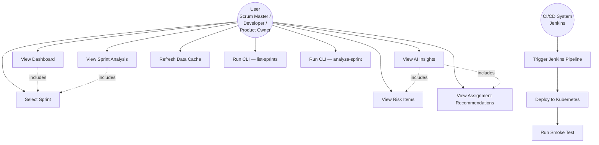
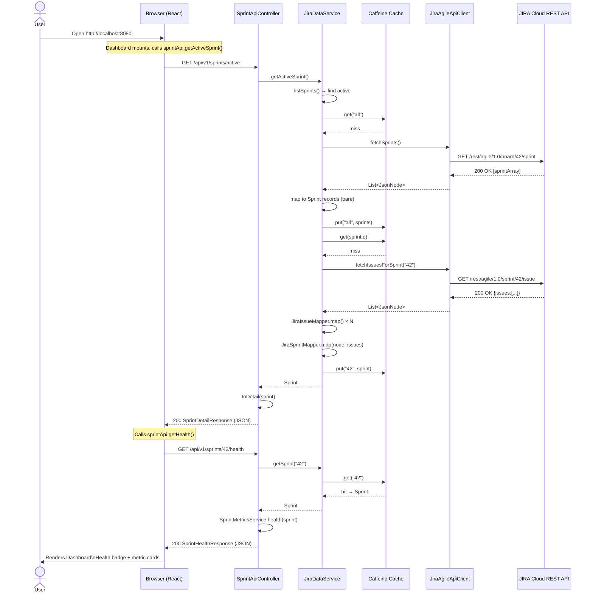
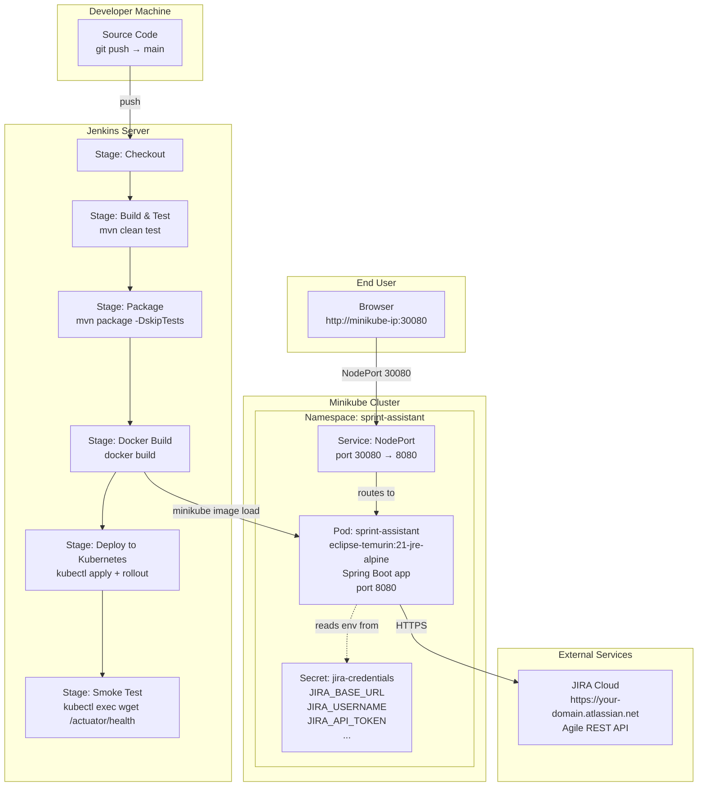

# UML Diagrams
## JIRA Sprint AI Assistant

**Course:** Software Engineering & Project Management (S5CCS02), 2026–27 ODD SEM

All diagrams are written in [Mermaid](https://mermaid.js.org/) and render natively in GitHub, GitLab, and most modern markdown viewers.

---

## 1. Use Case Diagram



---

## 2. Activity Diagram — From Browser Open to Sprint Analysis

```mermaid
flowchart TD
    A([User opens browser]) --> B[React app loads at /]
    B --> C[Dashboard page mounts]
    C --> D{Fetch active sprint\nGET /api/v1/sprints/active}
    D -->|Cache hit| E[Return cached Sprint]
    D -->|Cache miss| F[JiraAgileApiClient\ncalls JIRA API]
    F --> G{JIRA returns\n200 OK?}
    G -->|Yes| H[Map JSON → Sprint + Issues]
    H --> I[Store in Caffeine cache]
    I --> E
    G -->|No| J[Throw JiraApiException]
    J --> K[ApiExceptionHandler\nreturns HTTP 500]
    K --> L[React shows error state]
    E --> M[SprintMetricsService.health]
    M --> N{Completion rate\n≥ 80% and\nblocked ≤ 20%?}
    N -->|Yes| O[status = HEALTHY]
    N -->|No| P{Rate ≥ 60% or\nblocked ≤ 40%?}
    P -->|Yes| Q[status = WATCH]
    P -->|No| R[status = AT_RISK]
    O --> S[Render Dashboard\nHealth badge + metric cards]
    Q --> S
    R --> S
    S --> T[User selects sprint\nfrom dropdown]
    T --> U[Fetch GET /api/v1/sprints/{id}/analysis]
    U --> V[Render Sprint Analysis page\nChart + Workload table + Issue table]
    V --> W([Done])
```

---

## 3. Sequence Diagram — Browser → React → Spring Boot → JIRA API



---

## 4. Deployment Diagram


